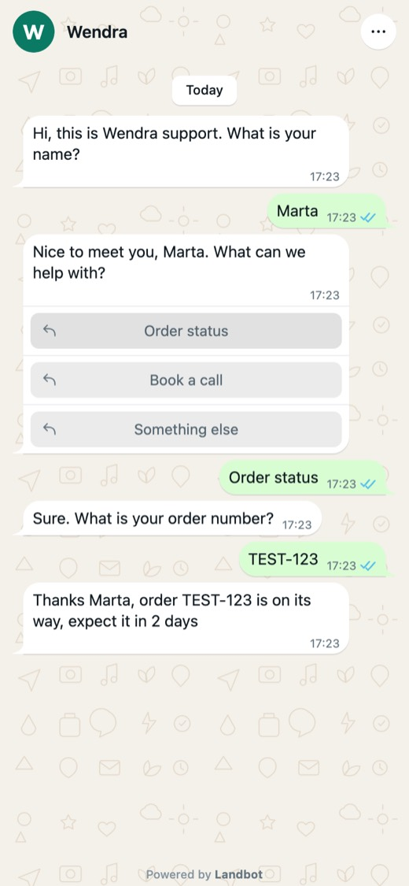

# WhatsApp lookalike

A web chat that reads like a messenger thread, ticks and all.

| | |
|---|---|
| Use case | Support |
| Channel | Landbot web chat |
| Runs as | **Wendra** (invented) |
| Language | English |
| Try it | [Try it live](https://landbot.pro/v3/H-3514728-BX6Q6HCOMGIG6RS3/index.html) |

> **On hold.** The live demo has known issues (mic and menu do nothing, no mobile keyboard handling, slow loader). Its CSS/JS stays out of the repo until the fixed version passes the iPhone test.

## Build it in your own account

Follow [`RECIPE.md`](RECIPE.md) with your agent and the
[Landbot plugin](https://github.com/landbot-org/experience-library#what-you-need). Check its status first: a recipe
with a section marked PENDING is not ready to build.

## What is in this folder

| File | What it is |
|---|---|
| [`RECIPE.md`](RECIPE.md) | How to build it with the Landbot plugin |
| [`preview.jpg`](preview.jpg) | Screenshot of the live bot at phone width |

## Export status

| Layer | In this repo |
|---|---|
| Flow (blocks and connections) | — |
| AI agents | — |
| Channel Custom CSS | — |
| Channel Custom JS | — |
| Media used in the flow | — |

[← Back to the library](https://github.com/landbot-org/experience-library#try-them)
