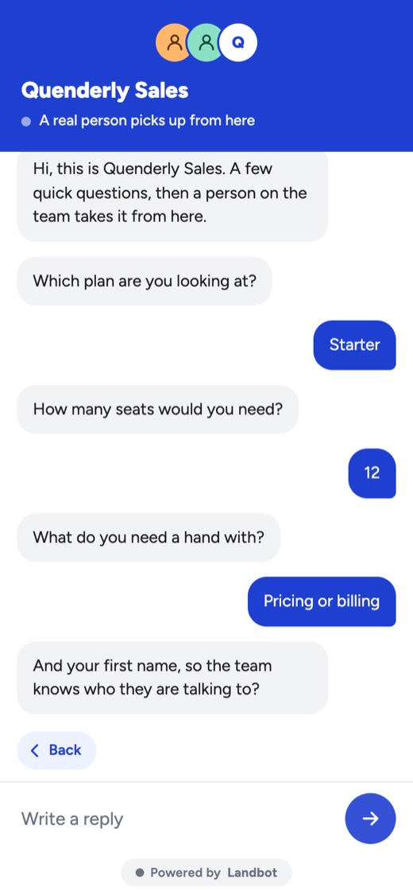

# Bot-to-human handoff

The bot collects the context, then a person takes over.

| | |
|---|---|
| Use case | Support |
| Channel | Landbot web chat |
| Runs as | **Quenderly** (invented) |
| Language | English |
| Try it | [Try it live](https://landbot.pro/v3/H-3517955-1I10TFZYN1KVK5S3/index.html) |

## How it opens

> Hi, this is Quenderly Sales. A few quick questions, then a person on the team takes it from here.

## What is in this folder

| File | What it is |
|---|---|
| [`preview.jpg`](preview.jpg) | Screenshot of the live bot at phone width |
| [`channel/style.css`](channel/style.css) | The channel's Custom CSS, as published |
| [`channel/custom.js`](channel/custom.js) | The channel's Custom JS, as published |
| [`channel/config.json`](channel/config.json) | Design settings, welcome message and texts, as published |
| [`channel/assets/`](channel/assets/) | Media referenced by the channel config (avatar, logo) |

## Export status

| Layer | In this repo |
|---|---|
| Flow (blocks and connections) | — |
| AI agents | — |
| Channel Custom CSS | ✅ |
| Channel Custom JS | ✅ |
| Media used in the flow | — |

**It cannot be rebuilt from this repo yet.** There is no recipe for it,
and its flow has not been exported. Until then, try it live.

Its look depends on Custom JS. Landbot serves Custom JS only to accounts
with the Custom Code feature, so a rebuild on an account without it will
not look like the preview.

[← Back to the library](https://github.com/landbot-org/experience-library#try-them)
