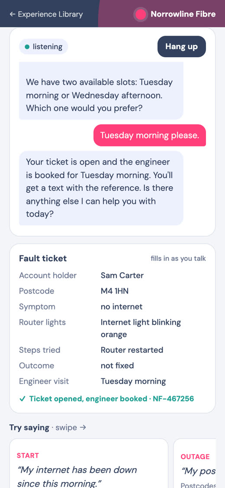

# Broadband troubleshooting

Checks your area, walks you through the router lights, and books an engineer if a restart fails.

| | |
|---|---|
| Use case | Support |
| Channel | Voice agent (ElevenLabs) |
| Runs as | **Norrowline Fibre** (invented) |
| Language | English |
| Try it | [Talk to it live](https://experiences.getagent.page/voice/fibre-support) |

## What is in this folder

| File | What it is |
|---|---|
| `preview.jpg` | Screenshot of the live call at phone width |

## Rebuilding it

Not possible from this repo. Voice agents run on ElevenLabs, not Landbot,
and their configuration is not exported here. Calls end after four minutes;
the card beside the call shows what would land in the Landbot inbox.

[← Back to the library](https://github.com/landbot-org/experience-library#try-them)
